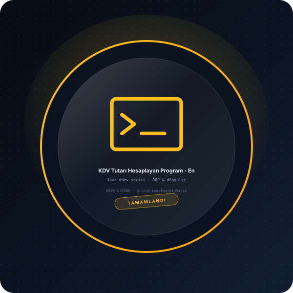

# KDV Tutarı Hesaplayan Program - Enes Öztürk



> **Java · nesne yönelimli programlama** — tasarım ve geliştirme: **Enes Öztürk**

---

Java ile kullanıcıdan alınan tutarın KDV tutarını ve KDV'li fiyatını hesaplayan program, interaktif Java konsol simülatörü ve ödev teslim raporu.

## Öne çıkanlar

- Sınıf ve metot yapısı, kapsülleme ve kalıtım
- Döngü, koşul ve koleksiyon kullanımı
- Konsol çıktısı ve girdi doğrulama
- Arayüzde canlı simülasyon ve kaynak kod görünümü

## Kurulum ve çalıştırma

```bash
npm install
npm run dev        # http://localhost:3000
```

| Komut | Not |
| --- | --- |
| `npm install` | bağımlılıklar |
| `npm run dev` | geliştirme sunucusu |
| `npm run build` | üretim derlemesi |

## Proje yapısı

```
├── index.html
├── package.json
├── docs/rozet.svg        # imza rozeti
└── src/                  # uygulama kaynakları
```

## Lisans

Bu proje **Enes Öztürk** tarafından geliştirilmiştir; tüm hakları saklıdır.
